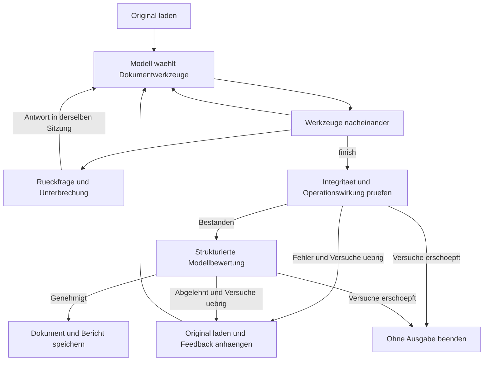

# docx-agent

**Beschreiben Sie die gewünschten Änderungen an einem vorhandenen Word-Dokument.** Das Programm
erstellt eine separate `.docx`-Datei und einen Prüfbericht. Es läuft im Terminal, nicht auf einer
Website. Für die folgende Anleitung brauchen Sie keine Programmierkenntnisse.

[English](README.md) · **Deutsch**

**Sie möchten nur ein Ergebnis ansehen?** Laden Sie die [Eingabedatei](samples/therapy_session_note/input.docx)
und die [echte Gemini-Ausgabe](samples/therapy_session_note/output.docx) herunter. Öffnen Sie beide
in Word oder LibreOffice. Auf GitHub: Dateiseite öffnen und **Download raw file** wählen.
Dafür benötigen Sie weder Installation noch API-Schlüssel. Alle Personen und Notizen in den
Beispielen sind **frei erfunden**.

Zum Ausprobieren folgen Sie den Schritten 1–8. Technische Informationen finden Sie unter
[Architektur](#architektur), [Tests](#tests-und-ergebnisse) und [Grenzen](#grenzen).
Die Programmausgabe und die reproduzierbaren Beispielanweisungen sind auf Englisch.

## 1. Projekt herunterladen

1. Öffnen Sie [das Repository](https://github.com/imhauke/olympAG-OA).
2. Wählen Sie **Code → Download ZIP** und entpacken Sie die Datei. Eine erhaltene Review-ZIP
   können Sie stattdessen direkt entpacken.
3. Speichern Sie den Ordner lokal, zum Beispiel unter `Dokumente`, außerhalb von iCloud/OneDrive.

**Erwartetes Ergebnis:** Der Ordner enthält `pyproject.toml`, `README.md`, `src` und `samples`.
Git wird nicht benötigt. Für die erste Installation ist eine Internetverbindung nötig.

## 2. uv installieren

`uv` installiert Python und die benötigten Pakete für Sie. Öffnen Sie **Terminal** unter
macOS/Linux oder **PowerShell** unter Windows. Kopieren Sie nur den Befehl für Ihr System und
drücken Sie die Eingabetaste.

**macOS/Linux**

```sh
curl -LsSf https://astral.sh/uv/install.sh | sh
```

**Windows PowerShell**

```powershell
winget install --id=astral-sh.uv -e
```

Schließen und öffnen Sie das Terminal erneut. Prüfen Sie die Installation:

```sh
uv --version
```

**Erwartetes Ergebnis:** `uv`, gefolgt von einer Versionsnummer. Wird der Befehl nicht gefunden,
helfen die [offiziellen Installationshinweise](https://docs.astral.sh/uv/getting-started/installation/).

## 3. Projekt öffnen und installieren

**macOS/Linux:** Tippen Sie `cd` und ein Leerzeichen. Ziehen Sie den entpackten Projektordner
in das Terminal und drücken Sie Enter. Alternativ schreiben Sie nach `cd` den vollständigen
Ordnerpfad in doppelten Anführungszeichen.

**Windows:** Öffnen Sie den entpackten Ordner im Explorer. Klicken Sie mit der rechten Maustaste
auf eine freie Fläche und wählen Sie **Im Terminal öffnen**. Verwenden Sie PowerShell.
Alternativ schreiben Sie nach `cd` den Ordnerpfad in doppelten Anführungszeichen.

Führen Sie **alle weiteren Befehle aus diesem Ordner** aus. Kopieren Sie nur den Befehl, ohne
Markdown-Zeichen oder ein vorangestelltes `$`.

```sh
uv sync --locked
```

**Erwartetes Ergebnis:** Python 3.12 und die Pakete werden in `.venv` installiert oder als bereits
installiert erkannt. Die Paketanzahl kann abweichen. Sie müssen `.venv` nicht aktivieren und
Python nicht separat installieren.

Prüfen Sie den Programmstart:

```sh
uv run docx-agent version
```

**Erwartete Ausgabe:** `0.1.0`.

## 4. Ohne API-Schlüssel ausprobieren

Lesen Sie das Beispieldokument:

```sh
uv run docx-agent inspect samples/therapy_session_note/input.docx
```

**Erwartetes Ergebnis:** Absätze und Tabellenzellen werden mit IDs angezeigt. Unter anderem:

```text
[p0] (heading 1) "Session Note - Max Mustermann"
  [t0.r1.c1.p0] "8h"
```

Prüfen Sie die bereits erzeugte Beispielausgabe:

```sh
uv run docx-agent verify samples/therapy_session_note/input.docx samples/therapy_session_note/output.docx
```

**Erwartetes Ergebnis:** eine Liste der Änderungen, am Ende `OK: integrity checks passed.`
Beide Befehle führen **keine Modellaufrufe** aus. Hier finden Sie [alle drei Beispiele](samples/README.md).

## 5. Gemini-Schlüssel eintragen

### Kostenloser Testschlüssel für sieben Tage

Für die Begutachtung stellt der Autor einen Gemini-Testschlüssel **privat** bereit. Er gilt
sieben Tage ab dem in der Übergabenachricht genannten Zeitpunkt. Diese Nachricht soll das
genaue Ablaufdatum und die Uhrzeit enthalten. Für den ersten Test müssen Sie damit kein eigenes
Google-API-Projekt einrichten.

Der Schlüssel ist **nicht im öffentlichen Repository enthalten**. Haben Sie eine vorbereitete
`.env` erhalten, legen Sie diese neben `pyproject.toml` ab und fahren Sie mit **Schritt 6** fort.
Der Schlüsselinhaber verwaltet den Ablauf; die Anwendung schaltet den Schlüssel nicht selbst
nach sieben Tagen ab. Siehe [Übergabehinweise für den Autor](docs/REVIEW_HANDOFF.md).

### Lokale Einstellungen anlegen

Kopieren Sie die Vorlage nur, wenn noch **keine** `.env` vorhanden ist:

**macOS/Linux**

```sh
cp .env.example .env
```

**Windows PowerShell**

```powershell
Copy-Item .env.example .env
```

Öffnen Sie `.env` in einem einfachen Texteditor:

| System | Befehl |
|---|---|
| macOS | `open -e .env` |
| Windows | `notepad .env` |
| Linux | `nano .env` oder Ihr Texteditor |

Setzen Sie diese Zeilen; lassen Sie die anderen Einstellungen unverändert:

```dotenv
GEMINI_API_KEY=PASTE_THE_KEY_YOU_RECEIVED_HERE
DOCX_AGENT_MODEL=gemini-3.5-flash-lite
DOCX_AGENT_MAX_TURNS=5
DOCX_AGENT_MAX_RETRIES=0
```

Ersetzen Sie den Platzhalter hinter `GEMINI_API_KEY=` durch den erhaltenen Schlüssel. Speichern
Sie die Datei als **`.env`**, nicht als `.env.txt`. Verwenden Sie einen Texteditor, nicht Word.
In nano: Strg+O, Enter, dann Strg+X. Teilen oder committen Sie diese Datei nicht.

**Erwartetes Ergebnis:** `.env` liegt neben `pyproject.toml`. Mit diesen Testeinstellungen sind
höchstens fünf Bearbeitungsaufrufe und ein Prüfaufruf pro Bearbeitung erlaubt; es gibt keine
Wiederholung durch Zurücksetzen des Dokuments.

**Nach Ablauf oder ohne Testschlüssel:** Erstellen Sie einen eigenen Schlüssel in
[Google AI Studio](https://aistudio.google.com/apikey) gemäß
[Googles Anleitung](https://ai.google.dev/gemini-api/docs/api-key). Ersetzen Sie in `.env`
`GEMINI_API_KEY`. Modellzugang und Kontingent hängen vom Google-Projekt ab. Der kostenlose Zugang
ist nicht unbegrenzt; siehe [aktuelle Preise](https://ai.google.dev/gemini-api/docs/pricing).

## 6. Erste echte Bearbeitung starten

**Dabei werden Dokumenttext und Anweisung zur Bearbeitung und Prüfung an Google Gemini gesendet.**
Beginnen Sie mit den synthetischen Beispielen. Andere Dokumente dürfen Sie nur verwenden,
wenn Sie deren Inhalt an den Anbieter senden dürfen. Keine echten Patientenakten in dieser Demo.

Erstellen Sie einmal den Ausgabeordner. Existiert `out` bereits, überspringen Sie diesen Befehl:

```sh
mkdir out
```

Kopieren Sie den folgenden Befehl als **eine Zeile**. Die englische Anweisung bedeutet:
In der Zieltabelle den Schlafzielwert von `8h` auf `7.5h` ändern, alles andere beibehalten.

```sh
uv run docx-agent edit samples/therapy_session_note/input.docx "In the goals table, replace the sleep target 8h with 7.5h. Leave everything else unchanged." -o out/my-first-edit.docx --non-interactive
```

**Erwartetes Ergebnis:** Das Terminal nennt Modell und Aufrufgrenzen. Bei Erfolg erscheinen
`saved: ...` und ein Bericht mit `"ok": true`. Der Wortlaut der Modellbewertung kann variieren.
Es entstehen zwei Dateien:

| Datei | Inhalt |
|---|---|
| `out/my-first-edit.docx` | Das bearbeitete Word-Dokument. Der Schlafzielwert sollte `7.5h` sein. |
| `out/my-first-edit.report.json` | Änderungs- und Prüfbericht, mit einem Texteditor lesbar. |

Das Original bleibt unverändert. Eine erneute Ausführung mit denselben Pfaden kann vorhandene
Ausgabedateien ersetzen. Bei einem Modell-/Anbieterfehler erscheint eine Fehlermeldung statt
einer neuen Ausgabe.

## 7. Ausgabe prüfen

```sh
uv run docx-agent verify samples/therapy_session_note/input.docx out/my-first-edit.docx
```

**Erwartete Ausgabe für dieses Beispiel mit einer Änderung:**

```text
modified  t0.r1.c1.p0 -> t0.r1.c1.p0
  - '8h'
  + '7.5h'
OK: integrity checks passed.
```

Öffnen und kontrollieren Sie zusätzlich die Word-Datei. Die Integritätsprüfung erkennt
unbeabsichtigte Dokumentänderungen. Sie beweist weder das richtige Verständnis Ihrer Absicht
noch ein fehlerfreies Seitenlayout. Für absichtliche Überschriftenformatierung gelten die
Hinweise unter [Grenzen](#grenzen).

## 8. Weitere Anweisungen oder eigene Dokumente

Beginnen Sie mit **einer klaren Änderung**: Ort, alter Text und neuer Text.
Die folgenden englischen Eingaben passen zu den englischen Beispieldateien:

| Eingabedokument | Empfohlene Anweisung |
|---|---|
| `samples/therapy_session_note/input.docx` | `Add a bullet after Practised breathing exercises. reading Agreed to keep a sleep diary.` |
| `samples/treatment_plan/input.docx` | `Delete the entire paragraph Internal draft placeholder - remove before sharing. Preserve everything else.` |
| `samples/practice_letter/input.docx` | `Change the appointment from 20 March 2026 at 09:00 to 27 March 2026 at 10:30. Keep the formatting.` |
| `samples/practice_letter/input.docx` | `Apply Heading 1 to the heading Notes. Leave all other paragraphs unchanged.` |

Verwenden Sie den Befehl aus Schritt 6 und ersetzen Sie Eingabe, Anweisung in Anführungszeichen
und Ausgabepfad. Wählen Sie für jeden Versuch einen neuen Ausgabenamen. `Heading 1/2/3` entspricht
in Word **Überschrift 1/2/3**, also Kapitel, Unterkapitel und dessen Unterabschnitt.

Kopieren Sie ein eigenes zulässiges Dokument als `my-document.docx` in den Projektordner:

```sh
uv run docx-agent edit "my-document.docx" "Replace the heading Introduction and objectives with Introduction. Leave everything else unchanged." -o "out/my-document-edited.docx"
```

Setzen Sie Pfade und die gesamte Anweisung bei Leerzeichen in doppelte Anführungszeichen.
Vermeiden Sie zusätzliche, nicht maskierte doppelte Anführungszeichen innerhalb der Anweisung.
Fragt das Programm nach einer bestimmten Fundstelle, geben Sie die Antwort im **selben Terminal**
ein und drücken Sie Enter. Mit `--non-interactive` wird die Frage ausgegeben und das Programm
beendet; präzisieren Sie dann die Anweisung und starten Sie neu. Der Umgang mit Mehrdeutigkeit
ist nicht garantiert. Prüfen Sie deshalb jedes Ergebnis selbst.

## Wenn etwas nicht funktioniert

| Meldung oder Problem | Nächster Schritt |
|---|---|
| `uv` nicht erkannt / command not found | Terminal schließen und neu öffnen; Schritt 2 prüfen. |
| `pyproject.toml` nicht gefunden | In den entpackten Projektordner wechseln. |
| `Set GEMINI_API_KEY` | Nicht leeren Schlüssel in `.env` neben `pyproject.toml` speichern; auf `.env.txt` prüfen. |
| Editor/review model call failed | Verbindung, Ablauf/Widerruf, Kontingent und Modellzugang in [AI Studio](https://aistudio.google.com/) prüfen. Eventuell ist ein neuer Schlüssel nötig. |
| Keine Ausgabe nach fehlgeschlagener Prüfung | Grund lesen und Anweisung präzisieren. Beim ersten Test kein `--force` verwenden. |
| Clarification required | Gewünschtes Feld/Absatz nennen oder ausdrücklich alle Fundstellen beauftragen. |
| Eingabedatei nicht gefunden | Dateinamen und Anführungszeichen bei Pfaden mit Leerzeichen prüfen. |
| Ungültiger Ausgabepfad | Ausgabeordner anlegen; einen anderen Pfad als den Eingabepfad wählen. |
| `ModuleNotFoundError: docx_agent` in iCloud | Projekt außerhalb synchronisierter Ordner entpacken und `uv sync --locked` erneut ausführen. Siehe [Handoff](docs/HANDOFF.md). |

## Befehle und Einstellungen

| Befehl/Option | Wirkung |
|---|---|
| `inspect FILE.docx` | Lokale Ansicht ohne Modellaufrufe. |
| `verify BEFORE.docx AFTER.docx` | Lokale Integritätsprüfung ohne Modellaufrufe; `--json` liefert JSON. |
| `edit INPUT.docx "instruction" -o OUTPUT.docx` | Modell → Werkzeuge → Prüfungen → Modellbewertung → Speichern. |
| `--report PATH.json` | Eigener Berichtspfad; sonst z. B. `out/result.report.json` für `out/result.docx`. |
| `--dry-run` | **Ruft weiterhin das Modell auf**, prüft das Ergebnis, schreibt keine Dateien. |
| `--non-interactive` | Beenden statt auf eine Rückfrageantwort zu warten. |
| `--model ID`, `--provider google_genai` | Modell/Anbieter ausdrücklich wählen; kein automatischer Ersatzanbieter. |
| `--force` | Letzten abgelehnten Versuch nach Wiederholungen speichern, weiterhin mit Fehlercode. Überschreibt weder Anbieterfehler noch Rückfragen. |
| `uv run docx-agent --help` | Hilfe; `edit --help` zeigt Bearbeitungsoptionen. |

Rückgabecodes: **0** Erfolg, **1** fehlgeschlagene Prüfung/Modellaufruf (auch bei erzwungener
Ausgabe), **2** ungültige Eingabe/Konfiguration oder Dateifehler, **3** nötige Rückfrage im
nicht interaktiven Modus.

Umgebungsvariablen haben Vorrang vor `.env`. Die folgenden Programmstandardwerte unterscheiden
sich von den bewusst niedrigeren Demo-Grenzen **5/0** in Schritt 5:

| Einstellung | Standard / Bedeutung |
|---|---|
| `GEMINI_API_KEY` | Für Gemini-Bearbeitung erforderlich; nicht für inspect/verify/Tests. |
| `DOCX_AGENT_PROVIDER` | `google_genai`; optional `anthropic` mit `ANTHROPIC_API_KEY`. |
| `DOCX_AGENT_MODEL` | Leer: erster `GEMINI_MODELS`-Eintrag, bei Anthropic `claude-sonnet-5-5`. Muss zum Anbieter passen. |
| `GEMINI_MODELS` | Beispiel: `gemini-3.5-flash-lite,gemini-3.6-flash`; nur der erste nicht leere Eintrag wird gewählt. |
| `DOCX_AGENT_EFFORT` | `medium`; auch `low`/`high`, sofern das Modell diese unterstützt. |
| `DOCX_AGENT_MAX_TURNS` | `30`, Bereich 1–100; gesamte Bearbeitungsaufrufe über alle Versuche. |
| `DOCX_AGENT_MAX_RETRIES` | `2`, Bereich 0–2; gemeinsame Zurücksetzungen nach Validierungs-/Bewertungsfehlern. |

Live geprüft: `gemini-3.5-flash-lite` mit mittlerem Denkaufwand. Andere Modelle und Anthropic
sind nicht live verifiziert. SDK-Wiederholungen sind deaktiviert. Nur die manuellen Beispiel-/
Eval-Runner bieten ausdrücklich aktivierbare HTTP-503-Wiederholungen; die normale CLI stoppt
bei Anbieterfehlern.

## Architektur

Ein expliziter Python-**LangGraph StateGraph** steuert den Ablauf. Nachrichten werden nur
angehängt und mit `InMemorySaver` gesichert. Das veränderliche Dokument liegt im Laufzeitkontext.
Das Diagramm zeigt den Standardablauf; `--force` übersteuert ausdrücklich den endgültigen Prüfungsfehler.



Eigene ZIP/OPC- und lxml-Operationen erhalten unberührte Paketbestandteile. Zitatbasierte
Änderungen verwenden stabile Block-IDs und beachten Text-Runs. Typisierte Werkzeuge erlauben
nur Dokumentoperationen, keinen Shellzugriff und keine Codeausführung. Originalbytes und
Snapshots je Operation ermöglichen Integritäts-/Wirkungsprüfungen und sauberes Zurücksetzen.
Ein separates Modell bewertet die Absicht; seine Zustimmung ist keine Garantie.

Weitere technische Einzelheiten auf Englisch: [Architektur und Integrität](docs/ARCHITECTURE.md),
[`document/`](src/docx_agent/document/), [`agent/`](src/docx_agent/agent/) und
[`cli.py`](src/docx_agent/cli.py).

## Tests und Ergebnisse

Diese vier Befehle führen alle **Offline-Prüfungen** aus; Schlüssel und Make sind nicht erforderlich:

```sh
uv run ruff check .
uv run ruff format --check .
uv run mypy
uv run pytest -q --cov --cov-report=term --cov-report=xml
```

Ist Make installiert, führt `make check` dieselben Prüfungen aus. Letzter vollständiger Lauf:
**269 Tests bestanden, 99,44 % Quellcodeabdeckung**; die Mindestabdeckung beträgt 85 %.
Die Push-/PR-CI verwendet nur simulierte Modelle. Unit-, Property-, Graph-, Korruptions- und
Beispieltests prüfen Pakete/Blöcke, Formatierung, geschützte Inhalte, Operationswirkung und das
erneute Öffnen mit python-docx. Kein pixelgenauer Layoutvergleich.
[Prüfdetails und Grenzen](docs/ARCHITECTURE.md#integrity-checks-and-their-limits).

[Drei gespeicherte Live-Beispiele](samples/README.md) zeigen echte Gemini-Ausgaben.
Die [Evaluation mit sechs Fällen](evals/baselines/2026-11-17.md) bestand zunächst **5/6**.
Nach einer Prompt-Korrektur zur Mehrdeutigkeit wurde nur dieser Fall wiederholt: **1/1**.
Insgesamt **30 Aufrufe**. Die anderen fünf Fälle wurden mit dem neuen Prompt nicht erneut
ausgeführt. Das ist weder ein abschließendes 6/6-Ergebnis noch eine statistische Zuverlässigkeitsaussage.

`make eval` zeigt nur den Plan ohne Modellaufrufe. Live-Evaluationen benötigen ausdrücklich
`--live`; siehe [Eval-Anleitung](evals/README.md). Der GitHub-Eval-Workflow ist **rein manuell**
und wurde während der Entwicklung nicht remote gestartet.
[Dokumentation der KI-gestützten Entwicklung](docs/DEVELOPMENT.md).

## Grenzen

- Nur vorhandene `.docx`-Dateien; keine `.doc`-/PDF-Konvertierung oder verschlüsselten Dokumente.
- Bearbeitung von Haupttext und Tabellenzellentext. Kopf-/Fußzeilen werden erhalten, nicht bearbeitet.
- Keine Tabellen-/Bildeinfügung, Änderung von Linkzielen oder Bearbeitung von Fußnoten,
  Kommentaren und Textfeldern. Geschützte Änderungs-/Feld-Runs werden abgelehnt; keine Ausgabe
  als nachverfolgte Änderungen.
- Textoperationen überschreiten keine Absatzgrenzen. Vorhandene Absatzstile sind anwendbar;
  keine neuen Stildefinitionen oder automatische Neuerstellung des Inhaltsverzeichnisses.
- **Das eigenständige `verify` beanstandet beabsichtigte Überschriftenstiländerungen.** Die
  Bearbeitungssitzung prüft diese mit genauen Berechtigungen im Bericht. Programmatisch gibt
  es `style_changes`; die eigenständige CLI hat dafür keine Option.
- Der Umgang mit Mehrdeutigkeit basiert auf Prompts. Modelle können weiterhin raten und
  falsche Änderungen genehmigen.
- Rückfragen lassen sich nur im selben Prozess/Sitzung fortsetzen. Keine Weboberfläche oder
  dauerhafte Wiederaufnahme.
- Snapshot-/Baumkopierkosten passen zu Fallstudiengrößen; keine Leistungsgarantie für große Dateien.
