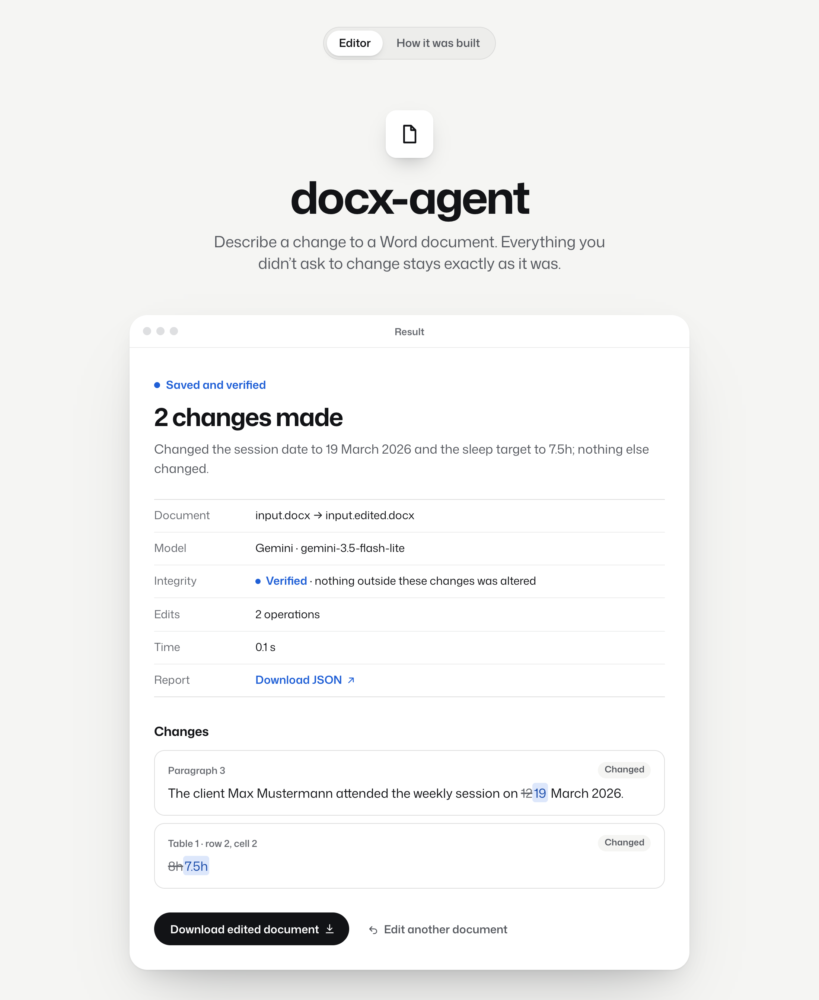
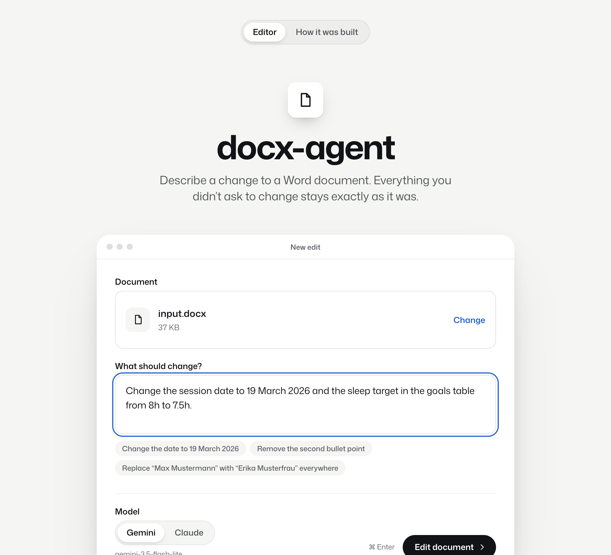

# docx-agent

Ein Python/LangGraph-Agent, der bestehende Word-Dokumente (`.docx`) nach Anweisungen in
natürlicher Sprache bearbeitet: Text einfügen, ersetzen und löschen, Absätze hinzufügen oder
entfernen und vorhandene Absatzstile anwenden. Alles, was Sie nicht ändern wollten, behält
Formatierung, Bilder und Tabellen. Nutzbar über ein interaktives Terminal-Menü oder eine lokale
Web-Oberfläche.



[English](README.md) · [Architektur & Integrität](docs/ARCHITECTURE.md) ·
[KI-gestützte Entwicklung](docs/DEVELOPMENT.md) · [Gemessene Evaluation](evals/baselines/2026-11-17-final.md)
· Die Web-Oberfläche enthält außerdem eine Seite **How it was built** mit den Entscheidungen
hinter dem Projekt.

## Schnellstart

Vier Schritte, etwa fünf Minuten. Ein Terminal in diesem Projektordner öffnen (dem Ordner mit
dieser README) und dort jeden Befehl einzeln in einer eigenen Zeile ausführen.

### Schritt 1: uv installieren (einmal pro Rechner)

[uv](https://docs.astral.sh/uv/) installiert das passende Python (3.12) und alle Abhängigkeiten.
Python muss nicht installiert sein.

macOS oder Linux:

```sh
curl -LsSf https://astral.sh/uv/install.sh | sh
```

Windows (PowerShell):

```powershell
powershell -ExecutionPolicy ByPass -c "irm https://astral.sh/uv/install.ps1 | iex"
```

Danach ein neues Terminal öffnen und prüfen, dass `uv --version` eine Versionsnummer ausgibt.

### Schritt 2: Abhängigkeiten installieren

```sh
uv sync --locked
```

Das lädt bei Bedarf Python 3.12 und installiert die fixierten Abhängigkeiten in `.venv`. Am Ende
steht eine Zeile wie `Installed … packages`.

> **macOS und iCloud Drive:** Liegt der Projektordner in iCloud (z. B. auf dem Schreibtisch oder
> in Dokumente mit aktivem iCloud-Sync), versteckt iCloud Dateien in `.venv`, und später erscheint
> `ModuleNotFoundError: No module named 'docx_agent'`. Die Umgebung außerhalb von iCloud ablegen:
>
> ```sh
> rm -rf .venv
> UV_PROJECT_ENVIRONMENT="$HOME/.venvs/docx-agent" uv sync --locked
> ln -s "$HOME/.venvs/docx-agent" .venv
> ```

### Schritt 3: API-Schlüssel hinterlegen

**Reviewer:** die privat erhaltene Datei `.env` in den Projektordner kopieren, neben diese
README. Fertig; weiter mit Schritt 4.

Alle anderen legen eine eigene `.env` aus der Vorlage an,

```sh
cp .env.example .env
```

(unter Windows: `copy .env.example .env`), öffnen `.env` in einem Texteditor und tragen
mindestens einen Schlüssel ein:

```dotenv
GEMINI_API_KEY=ihr_gemini_schluessel
ANTHROPIC_API_KEY=ihr_anthropic_schluessel
```

- `GEMINI_API_KEY` wählt **Gemini 3.5 Flash-Lite** (Standard; ein
  [kostenloser Schlüssel](https://aistudio.google.com/apikey) genügt).
- `ANTHROPIC_API_KEY` aktiviert **Claude Sonnet 5.5**.
- Optional, um die Kosten pro Bearbeitung zu begrenzen: `DOCX_AGENT_MAX_TURNS=5` und
  `DOCX_AGENT_MAX_RETRIES=0` (die Review-`.env` setzt beides bereits). Kommentare in eine eigene
  Zeile schreiben, nie hinter einen Wert.

Die Review-Schlüssel sind sieben Tage ab dem 2026-11-17 gültig (bis 2026-11-24); ihr Inhaber
widerruft beide danach. `.env` niemals committen (git ignoriert die Datei).

### Schritt 4a: Im Terminal-Menü bearbeiten

```sh
uv run docx-agent
```

Das öffnet das Menü:

```text
docx-agent  0.1.0
Edit Word documents with plain-language instructions.

Model      Gemini · gemini-3.5-flash-lite
Documents  3 found in documents/ and samples/

  1  Edit a document
  2  Preview a document (what the agent sees)
  3  Verify an edited copy against its original
  4  Switch model
  5  Open the web UI in your browser
  q  Quit

Choose (1):
```

1. **Enter** drücken (oder `1` tippen), um ein Dokument zu bearbeiten.
2. Ein Dokument über seine Nummer wählen. Die Liste zeigt Ihre eigenen Dateien aus
   [`documents/`](documents/README.md), frühere bearbeitete Kopien und drei synthetische Beispiele.
   Mit `p` lässt sich der Pfad einer beliebigen anderen `.docx` einfügen oder hineinziehen.
3. Die gewünschte Änderung eintippen und Enter drücken. Für einen ersten Versuch
   `samples/therapy_session_note/input.docx` wählen und eingeben:
   `In the goals table, change the sleep target from 8h to 7.5h.`
4. Den Fortschritt verfolgen: Lesen, Bearbeiten, Integritätsprüfung, Review. Ist unklar, welche
   von mehreren Stellen gemeint ist, fragt der Agent nach; Antwort eintippen und Enter drücken.
5. Das Ergebnis lesen: jede Änderung als Wort-Diff mit Fundstelle sowie der Pfad der bearbeiteten
   Kopie (`documents/edited/<name>.edited.docx`) und ihres JSON-Berichts. Das Original wird nie
   verändert, frühere Ergebnisse werden nie überschrieben.

Zurück im Menü prüft `3` jede bearbeitete Kopie erneut gegen ihr Original, `2` zeigt das
Dokument genau so, wie der Agent es sieht, `4` wechselt zwischen Gemini und Claude (wenn beide
Schlüssel gesetzt sind), `5` startet die Web-Oberfläche und `q` beendet. Strg+C beendet ebenfalls.

**Eigene Dokumente:** `.docx`-Dateien in den Ordner [`documents/`](documents/README.md) kopieren;
sie erscheinen beim nächsten Auswählen in der Liste. Alles in diesem Ordner bleibt lokal (von git
ignoriert).

### Schritt 4b: Im Browser bearbeiten

```sh
uv run docx-agent ui
```

Das startet die App auf <http://127.0.0.1:8765> und öffnet sie im Browser (oder `5` im Menü
wählen).



1. Auf **Choose a .docx file** klicken (oder eine Datei darauf ziehen).
2. Die Änderung unter **What should change?** beschreiben oder ein Beispiel anklicken.
3. **Gemini** oder **Claude** wählen. Angeboten werden nur Modelle mit Schlüssel in `.env`.
4. **Edit document** drücken (oder ⌘/Strg + Enter) und den Live-Fortschritt verfolgen. Stellt der
   Agent eine Frage, direkt dort antworten.
5. Die geprüften Änderungen lesen, dann **Download edited document** (und bei Bedarf den
   JSON-Bericht). Lehnen die Prüfungen oder das Review eine Bearbeitung ab, entsteht keine Datei,
   und der Grund wird angezeigt.

Der Reiter **How it was built** (<http://127.0.0.1:8765/docs>) erklärt die Entscheidungen hinter
dem Projekt. Den Server mit Strg+C beenden.

- Nur lokal: Der Server lauscht auf `127.0.0.1`, lehnt fremde `Host`-Header ab und verlangt bei
  jeder Anfrage, die Arbeit startet, einen UI-Header, damit andere Websites kein API-Guthaben
  verbrauchen können.
- Hochgeladene Dokumente werden im Speicher bearbeitet und nie auf die Festplatte geschrieben.
  Ergebnisse der letzten Bearbeitungen bleiben verfügbar, bis der Server stoppt.
- **Recent documents** speichert nur Dateiname, Anweisung, Modell, Ergebnis und Zeit (nie die
  Dokumente) in `~/.docx-agent/history.json`. Verschieben mit `DOCX_AGENT_HISTORY`, leeren mit
  **Clear**.
- Optionen: `--port 8780` für einen anderen Port, `--no-open`, um keinen Browser-Tab zu öffnen.

Bearbeitungen senden Dokumenttext und Anweisung an den gewählten Anbieter. Die synthetischen
Beispiele oder Dokumente verwenden, die Sie teilen dürfen, und niemals echte Patientendaten.

## Prüfen ohne API-Schlüssel

Diese Befehle rufen kein Modell auf:

```sh
uv run docx-agent inspect samples/therapy_session_note/input.docx
uv run docx-agent verify samples/therapy_session_note/input.docx samples/therapy_session_note/output.docx
make check
```

`inspect` zeigt die mit IDs versehene Ansicht, die der Agent liest. `verify` vergleicht ein
Original mit einer bearbeiteten Kopie und endet mit `OK: integrity checks passed.` Die
[drei Beispiele](samples/README.md) enthalten Eingabe, Anweisung, echte Gemini-Ausgabe, Diff und
Herkunftsnachweis; die Word-Dateien öffnen, um das Layout zu prüfen.

`make check` ist die einzige Qualitätsschranke, identisch in CI: Ruff-Lint und -Format, striktes
mypy und die vollständige pytest-Suite mit Coverage. Letzter Lauf: **317 Tests, 98,14 % Coverage**
(Minimum 85 %). Ohne Make:

```sh
uv run ruff check .
uv run ruff format --check .
uv run mypy
uv run pytest -q --cov
```

## Einzelbefehle (für Skripte)

Das Menü ist der einfachste Einstieg; jede Aktion gibt es auch als einzelnen Befehl:

```text
docx-agent                     interaktives Menü
docx-agent ui [--port 8765] [--no-open]
docx-agent inspect FILE.docx
docx-agent edit INPUT.docx "instruction" -o OUTPUT.docx [--provider anthropic]
docx-agent verify BEFORE.docx AFTER.docx [--json] [--allow-removed image]
```

```sh
mkdir -p out
uv run docx-agent edit samples/therapy_session_note/input.docx "In the goals table, change the sleep target from 8h to 7.5h." -o out/edited.docx --non-interactive
uv run docx-agent verify samples/therapy_session_note/input.docx out/edited.docx
```

- Pfade und Anweisungen mit Leerzeichen in Anführungszeichen setzen. Stelle, alten Text und
  Ersatz nennen.
- Eine Rückfrage pausiert den Lauf und wartet auf die Antwort; `--non-interactive` beendet
  stattdessen mit Code 3.
- Scheitern Validierung oder Review, wird auf das Original zurückgesetzt, solange Wiederholungen
  übrig sind. Bei Misserfolg wird nichts geschrieben; `--force` speichert einen letzten
  abgelehnten Versuch und endet trotzdem mit 1.
- `--dry-run` ruft das Modell auf, schreibt aber keine Dateien. `--report PATH.json` setzt den
  Berichtspfad (Standard: `OUTPUT.report.json`). `--model` und `--provider` überschreiben
  Einstellungen; Umgebungsvariablen überschreiben `.env`. Siehe `uv run docx-agent edit --help`.
- Exit-Codes: 0 Erfolg; 1 fehlgeschlagene Prüfung oder Modellaufruf; 2 ungültige Eingabe,
  Konfiguration oder I/O; 3 Rückfrage im nicht-interaktiven Modus.

## Architektur und Grenzen

Ein expliziter LangGraph-`StateGraph`: Laden → Agent/Tools → deterministische Validierung →
strukturiertes Modell-Review → Speichern, mit Rückfrage-Interrupts und begrenzten
Zurücksetzen-und-Feedback-Schleifen. Das veränderliche Dokument liegt im Laufzeitkontext;
gecheckpointete Nachrichten werden nur angehängt. Das Modell erhält nur typisierte
Dokument-Tools, nie Shell- oder Code-Ausführung. Eine sichere Bearbeitung braucht zwei
Modellaufrufe: einen Zug, der alle Änderungen anwendet und mit `finish` endet (automatisch
abgebrochen, wenn eine Änderung in diesem Zug scheitert), plus das Review. Das Terminal-Menü
(`src/docx_agent/menu.py`) und die Web-Oberfläche (`src/docx_agent/web/`, FastAPI mit statischem
HTML/CSS/JS ohne Build-Schritt) nutzen denselben Graphen und alle Prüfungen.

Die eigene `zipfile`/lxml-Schicht serialisiert nur den Haupt-XML-Teil neu. Alle anderen Teile
behalten ihren exakten Inhalt nach dem Entpacken; unberührte Blöcke werden als kanonisches XML
verglichen. Das ZIP als Ganzes muss nicht byte-identisch sein. python-docx erzeugt nur
Test-Fixtures und öffnet Testausgaben erneut; es speichert nie Agent-Ausgaben. Details:
[Prüfungen, Entscheidungen und Implementierung](docs/ARCHITECTURE.md).

- Unterstützt: Text im Fließtext und in Tabellenzellen sowie vorhandene Absatzstile. Nicht
  unterstützt: Kopf-/Fußzeilen, Fußnoten, Kommentare oder Textfelder bearbeiten; Tabellen oder
  Bilder einfügen; Hyperlink-Ziele ändern; Textbereiche über Absätze hinweg; Inhaltsverzeichnisse
  neu aufbauen. Geschützte Objekte, Felder und Überarbeitungen werden abgelehnt, nie still
  entfernt.
- Eigenständiges `verify` lehnt beabsichtigte Überschriftenstil-Änderungen ab; die
  Bearbeitungssitzung prüft sie mit exakten Berechtigungen pro Block.
- Rückfragen und Modell-Review garantieren nicht die Absicht. Die Absatzzuordnung im Prüfer ist
  heuristisch, und CI prüft keine gerenderten Seiten.
- Checkpoints liegen im Speicher: Eine pausierte Bearbeitung übersteht keinen Neustart.

## Evaluationen

`make eval` zeigt den Plan, ohne ein Modell aufzurufen. Ein Live-Lauf muss sein Aufruflimit
angeben:

```sh
uv run python -m evals.run --live --max-calls 36 --retry-unavailable
```

Sechs synthetische Fälle mit hartem gemeinsamem Aufrufbudget und höchstens einer 503-Wiederaufnahme
pro Fall. Auf GitHub laufen Evals nur per manuellem Start. [Runner-Details](evals/README.md).

Gemessen: Die erste Baseline bestand **5/6**; eine Prompt-Korrektur behob den Mehrdeutigkeitsfall.
Mit dem Prompt vor der `finish`-Optimierung im selben Zug bestanden **alle 6/6 Fälle** (35
Gemini-Aufrufe, Fall für Fall, da die kostenlose Stufe 15 Anfragen pro Minute erlaubt; jedes
Nichtbestehen war ein Anbieter-503). Jeder Fall bestand einmal: ein Korrektheitsnachweis, keine
gemessene Erfolgsquote. Neun weitere unbekannte Anweisungen liefen live auf Gemini und Claude
Sonnet 5.5: Keine gespeicherte Ausgabe verletzte die Integrität; Fehlschläge waren Ablehnungen
oder Anbieterfehler. [Abschließender Nachweis](evals/baselines/2026-11-17-final.md) ·
[erste Baseline](evals/baselines/2026-11-17.md).

Kosten: Alle Gemini-Läufe nutzten die kostenlose Stufe ($0). Claude Sonnet 5.5 diente nur der
Live-Verifikation, etwa $0,07 des vorab festgelegten Budgets von $2: **$1,93 sind noch übrig**.

## Fehlerbehebung

| Symptom | Lösung |
|---|---|
| `Got unexpected extra argument(s)` | Hinter dem Befehl wurde etwas mit eingefügt, z. B. ein `# Kommentar` (zsh wertet ihn nicht als Kommentar). Den Befehl allein ausführen. |
| `ModuleNotFoundError: No module named 'docx_agent'` (macOS) | Das Projekt liegt in iCloud Drive: die Drei-Zeilen-Lösung aus Schritt 2 verwenden. |
| Das Menü zeigt `no API key found` | Schritt 3: eine `.env` mit `GEMINI_API_KEY` oder `ANTHROPIC_API_KEY` in den Projektordner legen, dann neu starten. |
| `503 UNAVAILABLE` oder `429` | Der Anbieter ist ausgelastet oder begrenzt die Rate (vorübergehend). Eine Minute warten und erneut versuchen oder das Modell wechseln (`4` im Menü). Es wurde nichts gespeichert. |
| `port 8765 is already in use` | Die Web-Oberfläche läuft bereits in einem anderen Terminal: diese verwenden oder dort mit Strg+C beenden. Oder einen anderen Port wählen: `uv run docx-agent ui --port 8780`. |
| Eine Seite zeigt `{"detail":"Not Found"}`, oder eine Änderung erscheint nicht | Es läuft noch eine Web-Oberfläche, die vor der Code-Aktualisierung gestartet wurde. Mit Strg+C beenden und neu starten. |

## Projektstruktur

```text
src/docx_agent/document/   OPC-Paket-I/O, Blockindex, lauf-bewusste Bearbeitung, Integritätsprüfer (kein LLM)
src/docx_agent/agent/      LangGraph-Zustand, Tools, Prompts, Modelle, Graph
src/docx_agent/menu.py     interaktives Terminal-Menü
src/docx_agent/web/        lokale Web-Oberfläche (FastAPI + statische Dateien)
documents/                 Ihre .docx-Dateien für das Menü (Inhalt von git ignoriert)
samples/                   drei synthetische Beispiele mit echten Modellausgaben
tests/                     Unit-, Property-, Graph-, CLI-, Menü- und Web-Tests (Skript-Modell)
evals/                     manuelle Live-Evaluationen
docs/                      Architektur, Entwicklungsablauf, Übergabe
```
