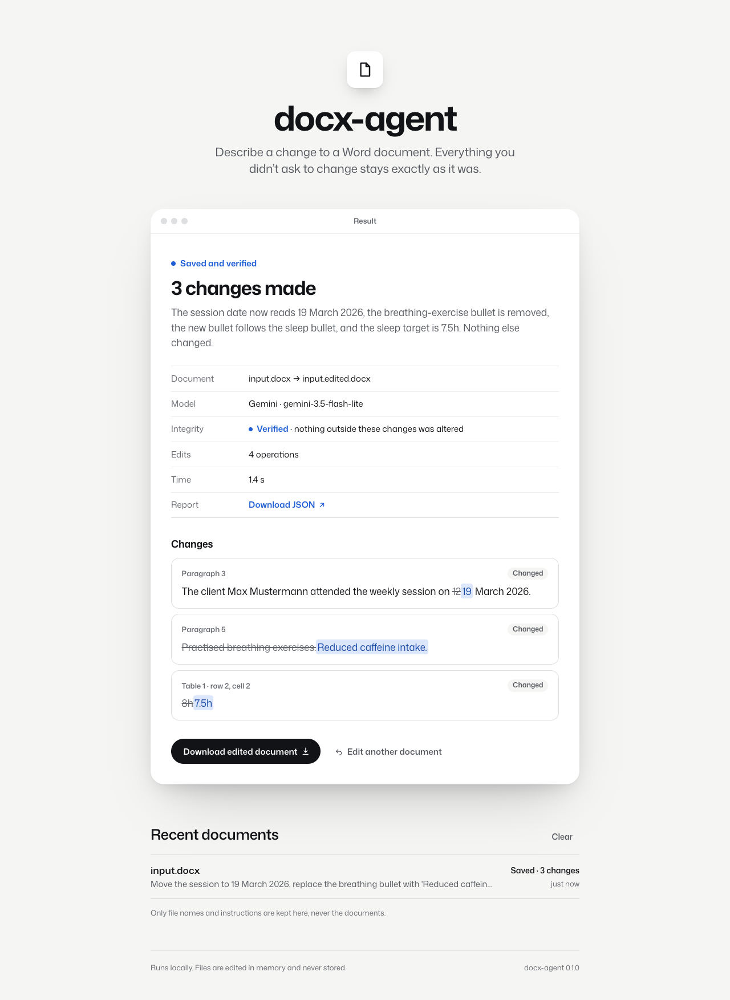

# docx-agent

Python/LangGraph agent for instruction-driven `.docx` edits: insert, replace, delete and apply
existing paragraph styles while preserving unaffected content and formatting. Use it from a local
web UI or the command line.



[Deutsch](README.de.md) · [Architecture & integrity](docs/ARCHITECTURE.md) ·
[AI development workflow](docs/DEVELOPMENT.md) · [Measured eval results](evals/baselines/2026-11-17-final.md)

## Run

Requires [uv](https://docs.astral.sh/uv/getting-started/installation/); Python 3.12 is selected
by `.python-version`. Run from the repository root:

```sh
uv sync --locked
```

**macOS + iCloud (Desktop/Documents sync):** iCloud marks files in `.venv` as hidden and Python
then skips the editable install (`ModuleNotFoundError: No module named 'docx_agent'`). Keep the
checkout outside iCloud, or keep only the environment outside it:

```sh
rm -rf .venv
UV_PROJECT_ENVIRONMENT="$HOME/.venvs/docx-agent" uv sync --locked
ln -s "$HOME/.venvs/docx-agent" .venv
```

Use the privately supplied review `.env`, or copy `.env.example` to `.env` and set:

```dotenv
GEMINI_API_KEY=your_key
ANTHROPIC_API_KEY=your_key
DOCX_AGENT_MAX_TURNS=5
DOCX_AGENT_MAX_RETRIES=0
```

`GEMINI_API_KEY` serves the default provider; `ANTHROPIC_API_KEY` enables Claude Sonnet 5.5.

The review `.env` contains courtesy **Gemini and Anthropic** keys, supplied privately and valid
for seven days from 2026-11-17 (until 2026-11-24); the owner revokes both at expiry. There is no
application-side expiry. Afterward, use your own [Gemini](https://aistudio.google.com/apikey) or
Anthropic key. Never commit `.env`. With Claude:
`uv run docx-agent edit ... --provider anthropic` (defaults to `claude-sonnet-5-5`).

### Web UI

```sh
uv run docx-agent ui
```

This starts the app on <http://127.0.0.1:8765> and opens it in your browser.

Choose a `.docx` (or drop it), describe the change, pick **Gemini** or **Claude** (only models
with a key in `.env` are offered) and press **Edit document** (⌘/Ctrl + Enter). Progress is shown
live; if the agent needs to know which of several matches you mean, it asks inline and continues
with your answer. The result lists every change as a word-level diff with its location, confirms
the integrity check, and offers the edited document plus the JSON report for download. If the
checks or the reviewer reject an edit, nothing is produced and the reason is shown.

- Local only: the server binds `127.0.0.1`, rejects other `Host` headers and requires a UI header
  on every request that starts work, so other websites cannot spend your API credit.
- Documents are edited in memory and never written to disk; results stay available for the most
  recent edits until the server stops.
- **Recent documents** keeps only file name, instruction, model, outcome and time (never the
  documents) in `~/.docx-agent/history.json`; move it with `DOCX_AGENT_HISTORY`, empty it with
  **Clear**.
- Options: `--port 8765`, `--no-open` (do not open a browser tab). Stop with Ctrl+C.

### Command line

```sh
mkdir -p out
uv run docx-agent edit samples/therapy_session_note/input.docx "In the goals table, replace the sleep target 8h with 7.5h. Leave everything else unchanged." -o out/edited.docx --non-interactive
uv run docx-agent verify samples/therapy_session_note/input.docx out/edited.docx
```

PowerShell: create the folder with `New-Item -ItemType Directory -Force out`.
Expected: `saved: ...`, `out/edited.docx`, `out/edited.report.json`, and verification ending in
`OK: integrity checks passed.` The input is preserved. Output paths can be overwritten on rerun.

`edit` sends document text/instructions to Gemini. Use the synthetic examples or documents
you are permitted to share; no real patient data. The settings above cap an edit at five editor
calls plus one review. Application defaults are 30 turns and two shared validation/review resets.

## Review without a key

```sh
uv run docx-agent inspect samples/therapy_session_note/input.docx
uv run docx-agent verify samples/therapy_session_note/input.docx samples/therapy_session_note/output.docx
make check
```

`inspect`, `verify` and tests make no model calls. The [three samples](samples/README.md) include
input, instruction, actual Gemini output, diff and integrity/provenance reports. Open the Word
files to inspect their layout.

`make check` = Ruff lint/format + strict source mypy + full pytest/coverage, also run in CI.
Last gate: **296 tests, 98.58% source coverage** (minimum 85%). Without Make, run:

```sh
uv run ruff check .
uv run ruff format --check .
uv run mypy
uv run pytest -q --cov --cov-report=term --cov-report=xml
```

## Interface and behavior

```text
docx-agent ui [--port 8765] [--no-open]
docx-agent inspect FILE.docx
docx-agent edit INPUT.docx "instruction" -o OUTPUT.docx
docx-agent verify BEFORE.docx AFTER.docx [--json] [--allow-removed image]
```

- Quote paths/instructions containing spaces. Give the location, old text and replacement.
- Clarification pauses the graph; answer in the same process. `--non-interactive` exits 3 instead.
- Validation/review failures reset to the original while retries remain. Nothing is published
  on failure; `--force` saves a final rejected attempt and still exits 1.
- `--dry-run` still calls the model but writes no files. `--report PATH.json` sets the report
  path; otherwise `result.docx` produces `result.report.json`.
- `--model`/`--provider` override settings. Environment variables override `.env`. See
  `.env.example` and `uv run docx-agent edit --help` for options. Both providers are live-tested:
  Gemini by the evals and samples, Claude Sonnet 5.5 by unseen live cases (`verify` OK). SDK
  retries are disabled; there is no provider fallback.
- Exit codes: 0 success; 1 failed checks/model call; 2 invalid input/configuration or I/O;
  3 non-interactive clarification.

## Architecture and limits

Explicit `StateGraph`: load → agent/tools → validate → structured model review → save, with
clarification interrupts and bounded reset/feedback loops. The mutable document is in runtime
context; checkpointed messages are append-only. Tools expose document operations, no shell/code execution.
A confident edit needs two model calls: one turn that applies all edits and ends with `finish`
(cancelled automatically if any edit in that turn fails), plus the review. The web UI
(`src/docx_agent/web/`, FastAPI + static HTML/CSS/JS, no build step) runs the same graph in a
worker thread and streams node updates as progress; the CLI and UI share every check.

Own `zipfile`/lxml operations reserialize only the main XML part. Unaffected part contents stay
byte-identical **after decompression**; untouched blocks are compared by canonical XML. The
complete ZIP need not be byte-identical. python-docx creates fixtures/reopens test outputs;
it never saves agent output. [Checks, decisions and implementation](docs/ARCHITECTURE.md).

- Body/table-cell text and existing paragraph styles only. No header/footer, footnote/comment/
  text-box editing, table/image insertion, hyperlink-target changes, cross-paragraph text spans
  or automatic TOC rebuilding. Protected objects/fields/revisions are refused, not silently dropped.
- Standalone `verify` rejects intended heading-style changes. The edit session validates those
  using exact per-block permissions; the programmatic checker accepts `style_changes`.
- Ambiguity handling and model review are not guarantees of intent. The checker has heuristic
  paragraph alignment/format comparison limits; CI does not validate rendered pages.
- Checkpoints are in-process only. Snapshot/tree-copy costs target case-study documents.

## Evaluations

`make eval` prints a plan without calls. Explicit live runs use:

```sh
uv run python -m evals.run --live --max-calls 36 --retry-unavailable
```

Six synthetic cases; hard shared call budget; optional single 503 resume per case inside that
budget. GitHub evals are `workflow_dispatch` only. [Runner details](evals/README.md).
Measured: first baseline **5/6**, then a prompt fix for the ambiguity case. With the prompt
before the same-turn `finish` optimization **all 6/6 cases passed** (35 Gemini calls, run case by case because the free tier allows
15 requests/minute; every non-pass was a provider 503). Each case passed once: not a measured
pass rate. Nine further unseen instructions (add/remove/replace, link text, logo removal, an
unsupported table, a German macOS-written `.docx`) were checked live on Gemini and Claude Sonnet
5.5: no saved output violated integrity; failures were rejections or provider errors. [Final evidence](evals/baselines/2026-11-17-final.md) ·
[first baseline](evals/baselines/2026-11-17.md).
