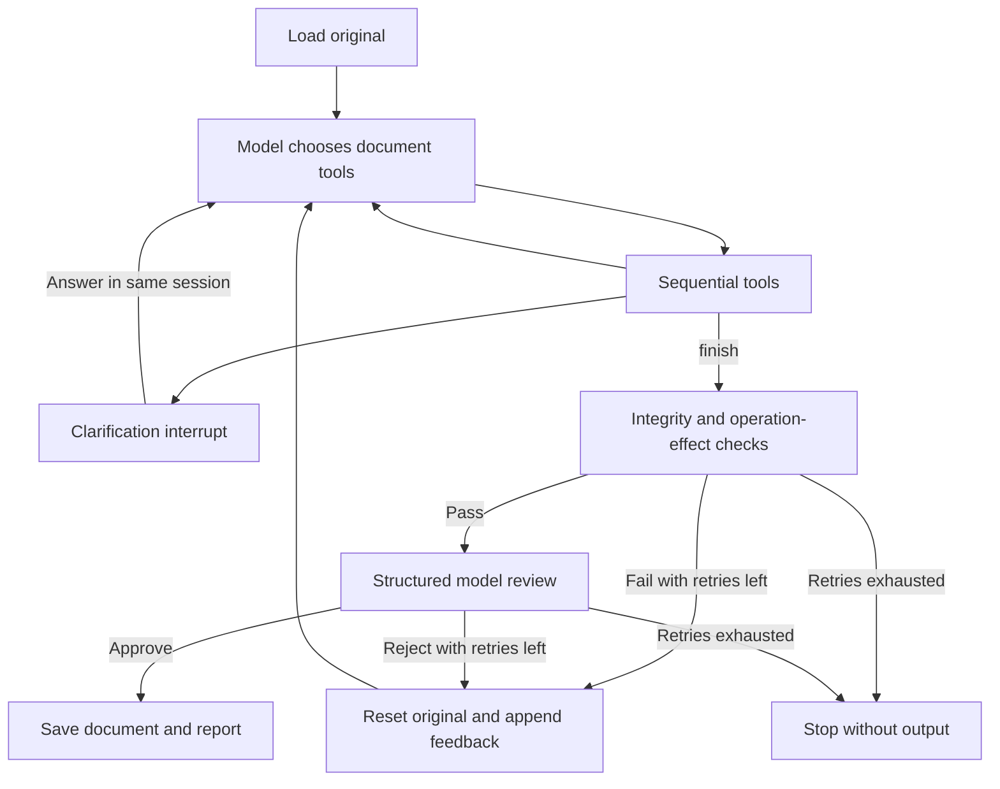

# docx-agent

**Edit an existing Word document by describing what you want to change.** You get a separate
`.docx` file and a report. This is a terminal application, not a website. The walkthrough below
requires no programming knowledge.

**English** · [Deutsch](README.de.md)

**Just want to see a result?** Download the [sample input](samples/therapy_session_note/input.docx)
and [real Gemini output](samples/therapy_session_note/output.docx), then open them in Word or
LibreOffice. On GitHub, open each file page and select **Download raw file**. No key or installation
is needed. All sample people and notes are **fictitious**.

To run the program, follow steps 1–8. For the implementation, jump to
[architecture](#architecture), [testing](#testing-and-results) or [limitations](#limitations).

## 1. Download the project

1. Open [the repository](https://github.com/imhauke/olympAG-OA).
2. Choose **Code → Download ZIP** and extract it. If you received a review ZIP, extract that instead.
3. Keep the folder somewhere local, such as `Documents`, outside iCloud/OneDrive.

**Expected result:** the folder contains `pyproject.toml`, `README.md`, `src` and `samples`.
You do not need Git. Initial installation needs an internet connection.

## 2. Install uv

`uv` installs Python and the required packages for you. Open **Terminal** on macOS/Linux or
**PowerShell** on Windows. Paste the command for your system and press Enter.

**macOS/Linux**

```sh
curl -LsSf https://astral.sh/uv/install.sh | sh
```

**Windows PowerShell**

```powershell
winget install --id=astral-sh.uv -e
```

Close and reopen the terminal, then run:

```sh
uv --version
```

**Expected result:** `uv` followed by a version number. If it is not found, see the
[official installation guide](https://docs.astral.sh/uv/getting-started/installation/).

## 3. Open the project and install it

**macOS/Linux:** type `cd` followed by a space, drag the extracted folder into the terminal,
then press Enter. Alternatively, type `cd` followed by its full path in double quotes.

**Windows:** open the extracted folder in File Explorer, right-click an empty area and select
**Open in Terminal**. Use PowerShell. Alternatively, type `cd` followed by the folder path in
double quotes.

Run **all remaining commands from this folder**. Copy the command text only, without Markdown
backticks or a prompt such as `$`.

```sh
uv sync --locked
```

**Expected result:** Python 3.12 and the packages are installed in `.venv`, or uv confirms they
are already installed. Package counts vary. You do not need to activate `.venv` or install Python yourself.

Check that the application starts:

```sh
uv run docx-agent version
```

**Expected output:** `0.1.0`.

## 4. Try it without an API key

Read the sample document:

```sh
uv run docx-agent inspect samples/therapy_session_note/input.docx
```

**Expected result:** paragraphs and table cells have IDs. These lines appear among the output:

```text
[p0] (heading 1) "Session Note - Max Mustermann"
  [t0.r1.c1.p0] "8h"
```

Check the already-generated sample output:

```sh
uv run docx-agent verify samples/therapy_session_note/input.docx samples/therapy_session_note/output.docx
```

**Expected result:** the example's changes, ending with `OK: integrity checks passed.`
Both commands make **no model calls**. See [all three samples](samples/README.md).

## 5. Add the Gemini key

### Seven-day courtesy access for reviewers

The author will supply a courtesy Gemini key **privately** for the review, valid for seven days
from the handover time stated in that message. The message should include its exact expiry date
and time. This avoids creating your own Google API project for the initial trial.

The key is **not included in the public repository**. If you received a preconfigured `.env`,
place it beside `pyproject.toml` and continue with **step 6**. The key owner manages its expiry;
the application does not automatically disable it after seven days. See the
[author's handover instructions](docs/REVIEW_HANDOFF.md).

### Create your settings file

Only if `.env` does **not** already exist, copy the example:

**macOS/Linux**

```sh
cp .env.example .env
```

**Windows PowerShell**

```powershell
Copy-Item .env.example .env
```

Open `.env` in a plain-text editor:

| System | Command |
|---|---|
| macOS | `open -e .env` |
| Windows | `notepad .env` |
| Linux | `nano .env`, or use your text editor |

Set the following lines; keep the other settings as they are:

```dotenv
GEMINI_API_KEY=PASTE_THE_KEY_YOU_RECEIVED_HERE
DOCX_AGENT_MODEL=gemini-3.5-flash-lite
DOCX_AGENT_MAX_TURNS=5
DOCX_AGENT_MAX_RETRIES=0
```

Replace the placeholder with your actual key. Save as **`.env`**, not `.env.txt`, using a text
editor rather than Word. In nano: Ctrl+O, Enter, then Ctrl+X. Do not share or commit this file.

**Expected result:** `.env` is beside `pyproject.toml`. These demo settings allow at most five
editor calls and one review call per edit, with no document-reset retries.

**After expiry, or without a courtesy key:** create your own key in
[Google AI Studio](https://aistudio.google.com/apikey), following
[Google's key instructions](https://ai.google.dev/gemini-api/docs/api-key), and replace
`GEMINI_API_KEY` in `.env`. Model access and quotas depend on your Google project. Free access
is not unlimited; see [current pricing](https://ai.google.dev/gemini-api/docs/pricing).

## 6. Make your first real edit

**This sends document text and your instruction to Google Gemini for editing and review.**
Start with the synthetic samples. Only use other documents you are allowed to send to the
provider; do not use real patient records in this demo.

Create an output folder once. Skip this command if `out` already exists:

```sh
mkdir out
```

Paste the following as **one line**:

```sh
uv run docx-agent edit samples/therapy_session_note/input.docx "In the goals table, replace the sleep target 8h with 7.5h. Leave everything else unchanged." -o out/my-first-edit.docx --non-interactive
```

**Expected result:** the terminal announces the model and call limits. On success, it prints
`saved: ...` and a report containing `"ok": true`. Review wording can vary. Two files appear:

| File | What it contains |
|---|---|
| `out/my-first-edit.docx` | The edited Word file. Open it: the sleep target should be `7.5h`. |
| `out/my-first-edit.report.json` | The change/check report, readable in a text editor. |

The original stays unchanged. Running the same command again can replace these output files.
A model/provider failure produces an error instead of a new output.

## 7. Check the output

```sh
uv run docx-agent verify samples/therapy_session_note/input.docx out/my-first-edit.docx
```

**Expected output for this one-change example:**

```text
modified  t0.r1.c1.p0 -> t0.r1.c1.p0
  - '8h'
  + '7.5h'
OK: integrity checks passed.
```

Also open the Word file and review it. Integrity checks detect unintended document changes;
they do not prove that the model understood your intent or that every page looks right.
For intentional heading-style changes, see [limitations](#limitations).

## 8. Try another instruction or your own document

Start with **one clear edit**: specify the location, the old text and the new text.

| Input document | Recommended instruction |
|---|---|
| `samples/therapy_session_note/input.docx` | `Add a bullet after Practised breathing exercises. reading Agreed to keep a sleep diary.` |
| `samples/treatment_plan/input.docx` | `Delete the entire paragraph Internal draft placeholder - remove before sharing. Preserve everything else.` |
| `samples/practice_letter/input.docx` | `Change the appointment from 20 March 2026 at 09:00 to 27 March 2026 at 10:30. Keep the formatting.` |
| `samples/practice_letter/input.docx` | `Apply Heading 1 to the heading Notes. Leave all other paragraphs unchanged.` |

Use the command from step 6, replacing its input, quoted instruction and output path. Choose a
new output name for each experiment. Heading 1/2/3 mean chapter/subsection/sub-subsection.

For your own permitted document, copy it into the project folder as `my-document.docx`:

```sh
uv run docx-agent edit "my-document.docx" "Replace the heading Introduction and objectives with Introduction. Leave everything else unchanged." -o "out/my-document-edited.docx"
```

Keep paths and the whole instruction in double quotes when they contain spaces. Avoid extra
unescaped double quotes inside the instruction. If asked which occurrence you mean, type an
answer and press Enter in the **same terminal session**. With `--non-interactive`, the program
prints the question and exits instead; refine the instruction and rerun. Model ambiguity
handling is not guaranteed, so review every output.

## If something goes wrong

| What you see | What to do |
|---|---|
| `uv` not recognized / command not found | Close/reopen the terminal; check step 2. |
| No `pyproject.toml` found | Return to the extracted project folder. |
| `Set GEMINI_API_KEY` | Save a nonempty key in `.env` beside `pyproject.toml`; check it is not `.env.txt`. |
| Editor/review model call failed | Check connection, expiry/revocation, quota and model access in [AI Studio](https://aistudio.google.com/). You may need a replacement key. |
| No output after a failed check | Read the reason and refine the instruction. Do not use `--force` for the first trial. |
| Clarification required | Name the intended field/paragraph, or explicitly request all occurrences. |
| Input file does not exist | Check the filename and quotes around paths with spaces. |
| Invalid output path | Create the output folder and choose a different path from the input. |
| `ModuleNotFoundError: docx_agent` in iCloud | Move/extract outside cloud-synced folders and rerun `uv sync --locked`. See the [handoff workaround](docs/HANDOFF.md). |

## Commands and configuration

| Command/option | Behavior |
|---|---|
| `inspect FILE.docx` | Local view; no model calls. |
| `verify BEFORE.docx AFTER.docx` | Local integrity check; no model calls. `--json` gives JSON. |
| `edit INPUT.docx "instruction" -o OUTPUT.docx` | Model → tools → checks → review → save. |
| `--report PATH.json` | Custom report path; e.g. `out/result.docx` otherwise gets `out/result.report.json`. |
| `--dry-run` | **Still calls the model**, checks the result, writes no files. |
| `--non-interactive` | Exit instead of waiting for clarification. |
| `--model ID`, `--provider google_genai` | Explicit model/provider; no automatic fallback. |
| `--force` | Save a final rejected attempt after retries, still exiting with failure. Does not override provider errors or clarification. |
| `uv run docx-agent --help` | Command help; `edit --help` lists edit options. |

Exit codes: **0** success, **1** failed checks/model call (including forced output), **2** bad
input/configuration or file I/O, **3** clarification needed in non-interactive mode.

Environment variables override `.env`. Application defaults below differ from the deliberately
lower **5/0** demo limits in step 5:

| Setting | Default / meaning |
|---|---|
| `GEMINI_API_KEY` | Required for Gemini edits; not for inspect/verify/tests. |
| `DOCX_AGENT_PROVIDER` | `google_genai`; optional `anthropic` needs `ANTHROPIC_API_KEY`. |
| `DOCX_AGENT_MODEL` | Empty: first `GEMINI_MODELS` entry, or `claude-sonnet-5-5` for Anthropic. Must match the provider. |
| `GEMINI_MODELS` | Example: `gemini-3.5-flash-lite,gemini-3.6-flash`; only the first nonempty entry is selected. |
| `DOCX_AGENT_EFFORT` | `medium`; also `low`/`high` where the model supports them. |
| `DOCX_AGENT_MAX_TURNS` | `30`, range 1–100; total editor calls across attempts. |
| `DOCX_AGENT_MAX_RETRIES` | `2`, range 0–2; shared validation/review reset limit. |

Live-tested: `gemini-3.5-flash-lite`, medium thinking. Other models and Anthropic are unverified.
SDK retries are disabled. Only the manual sample/eval runners offer an explicit HTTP 503 retry;
the application CLI stops on a provider error.

## Architecture

Python **LangGraph StateGraph** controls the edit workflow. Messages are append-only and
checkpointed with `InMemorySaver`; the mutable document lives in runtime context.
The diagram shows the default flow; `--force` explicitly overrides final failed-check handling.



Own ZIP/OPC + lxml operations preserve untouched parts. Quote-based edits use stable block IDs
and respect run boundaries. Typed tools expose document operations only, with no shell or code
execution. Original bytes and per-operation snapshots support integrity/effect checks and clean
retries. A separate model judge reviews intent; its approval is not a guarantee.

See [architecture, decisions and integrity details](docs/ARCHITECTURE.md),
[`document/`](src/docx_agent/document/), [`agent/`](src/docx_agent/agent/) and
[`cli.py`](src/docx_agent/cli.py).

## Testing and results

These four commands run the full **offline** gate; no key or Make installation is needed:

```sh
uv run ruff check .
uv run ruff format --check .
uv run mypy
uv run pytest -q --cov --cov-report=term --cov-report=xml
```

With Make installed, `make check` runs the same gate. Last full check: **269 tests passed,
99.44% source coverage**; coverage must stay above 85%. Push/PR CI uses scripted models only.
Unit, property, graph, corruption and sample tests check part/block preservation, formatting,
protected content, operation effects and reopening outputs with python-docx. Pixel layout is
not tested. [Details and checker limits](docs/ARCHITECTURE.md#integrity-checks-and-their-limits).

[Three committed live samples](samples/README.md) demonstrate actual Gemini output. The
[six-case evaluation](evals/baselines/2026-11-17.md) initially passed **5/6**; after an ambiguity
prompt fix, only that case was rerun, passing **1/1**. Total: **30 calls**. The other five were
not rerun under the new prompt; this is not a final-version 6/6 or a statistical reliability claim.

`make eval` prints a plan with no calls. Live evals require explicit `--live`; see
[eval instructions](evals/README.md). The GitHub eval workflow is **manual-only** and has not
been dispatched during development. [How AI assisted development](docs/DEVELOPMENT.md).

## Limitations

- Existing `.docx` files only; no `.doc`, PDF conversion or encrypted documents.
- Body paragraphs and table-cell text are editable. Headers/footers are preserved, not editable.
- No table/image insertion, hyperlink-target editing or footnote/comment/text-box editing.
  Protected tracked-change/field runs are refused; no tracked-changes output.
- Text edits do not span paragraphs. Apply existing paragraph styles; no new style creation or
  automatic table-of-contents rebuilding.
- **Standalone `verify` rejects intentional heading-style changes.** The edit session validates
  them with exact permissions in its report. Programmatic checking accepts `style_changes`;
  the standalone CLI has no equivalent flag.
- Ambiguity policy is prompt-based; models may still guess and judges may approve wrong edits.
- Clarification resumes only in the same process/session. No web UI or durable resume is included.
- Snapshot/tree-copy costs suit case-study sizes; no large-document performance guarantee.
