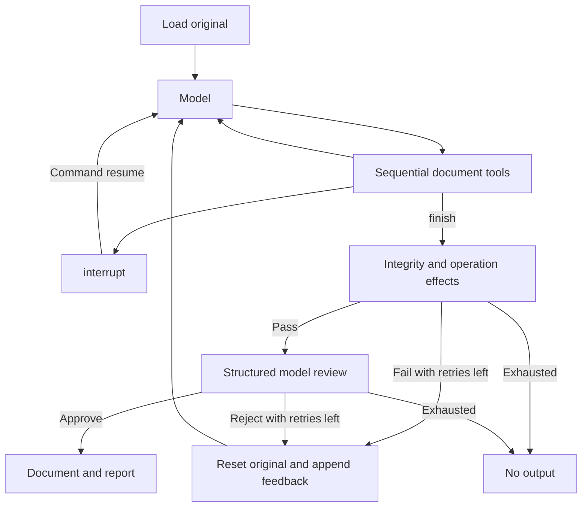

# Architecture and integrity

## Control flow

Default flow; `--force` can publish a final rejected attempt, still exiting 1. It does not
override provider failures, clarification or the turn cap. SDK retries are disabled.

## Implementation decisions

| Layer | Choice and reason |
|---|---|
| [`document/`](../src/docx_agent/document/) | Own OPC/ZIP + lxml editing. Non-main parts retain original bytes; python-docx is only a fixture/assertion dependency. |
| Addressing | Exact quotes, then normalized fallback; stable in-memory block IDs, inserted `n*` IDs and deleted tombstones. No IDs stamped into XML. |
| Run editing | Trim unchanged context; separate changes around token anchors; prepare multi-span replacements in a copied XML context for atomic refusal. |
| Styles | Apply an existing catalog style by changing only `w:pPr/w:pStyle`; other properties and runs remain protected. |
| [`agent/`](../src/docx_agent/agent/) | Explicit StateGraph, typed tools, no shell/code execution. Mutable `DocumentSession` in runtime context; append-only checkpointed messages. |
| Validation/review | Deterministic checks establish integrity; a separate JSON-schema judge assesses intent using changes, original text and actual touched-block styles. |

The session retains original bytes and per-operation receipts with before/after snapshots and
disk-ID mappings. Validation checks receipt continuity and each claimed effect, including
repeated/cancelling edits. This catches buggy insert/delete pairs that a final diff could call
a modification. Retry resets the document but appends feedback to the conversation.

`InMemorySaver` supports clarification in the same process/context; there is no durable resume.
Sequential tools live outside the interrupt node, so answers do not replay completed edits.
The CLI owns file paths. Saving stages both artifacts and rolls back ordinary publication errors;
the two-file publication is not crash-atomic.

## Integrity checks and limits

1. Same ZIP part names/order and compression/date metadata; every non-main part's **uncompressed
   content** is identical. Re-deflation/main XML serialization may change complete ZIP bytes.
2. Canonical XML equality for untouched paragraphs and the table/cell/section skeleton.
   Touched IDs and inserted counts must account for observed changes.
3. Paragraph properties stay identical except exact declared style assignments. Equal-text
   paragraphs compare all run/container character formats. Changed-text pairs skip equal
   stretches shorter than three characters; pairs below 0.5 text similarity skip format comparison.
   Paragraph alignment is heuristic. Property tests additionally check exact formatting outside spans.
4. Protected-content fingerprints cover drawings, fields, references, links, bookmarks, sections
   and revisions. Intended removals are restricted to changed/touched blocks; unknown content is read-only.
5. New structural/whitespace hazards and each operation's actual before/after effect are checked.
   Tests/evals reopen outputs with python-docx; no Word rendering or pixel comparison is performed.

Standalone `verify` assumes unchanged styles. Session checks accept exact `style_changes` permissions;
the CLI has no matching flag. Integrity and model approval do not guarantee correct user intent.
Snapshot/tree-copy costs target case-study documents, not large-document performance guarantees.
